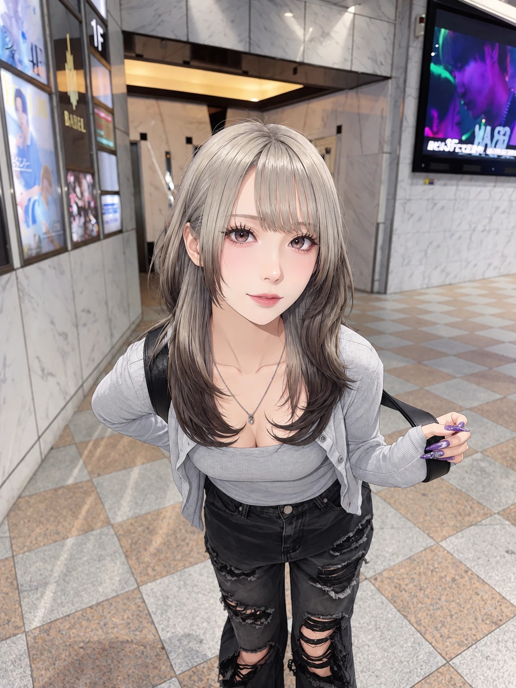
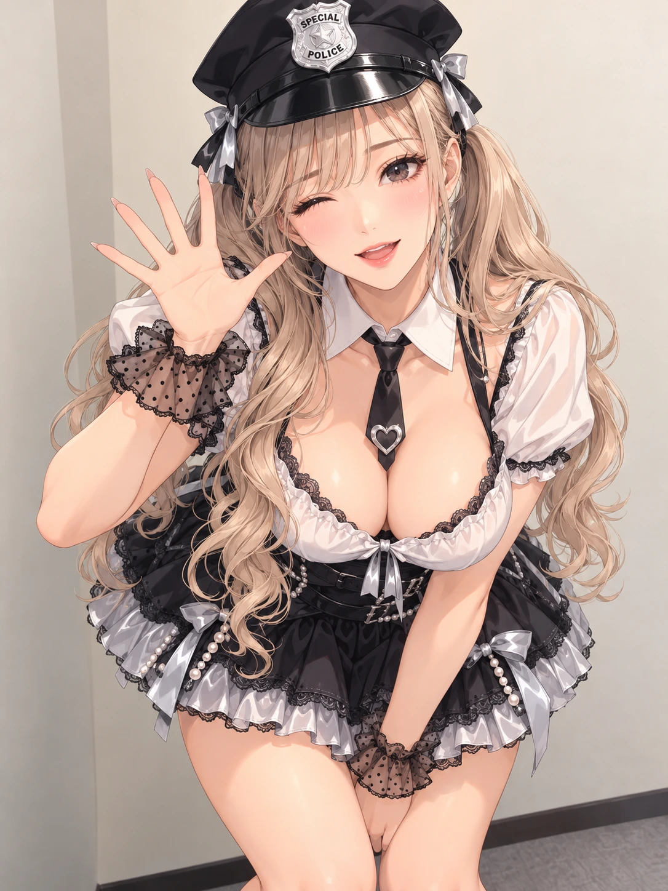
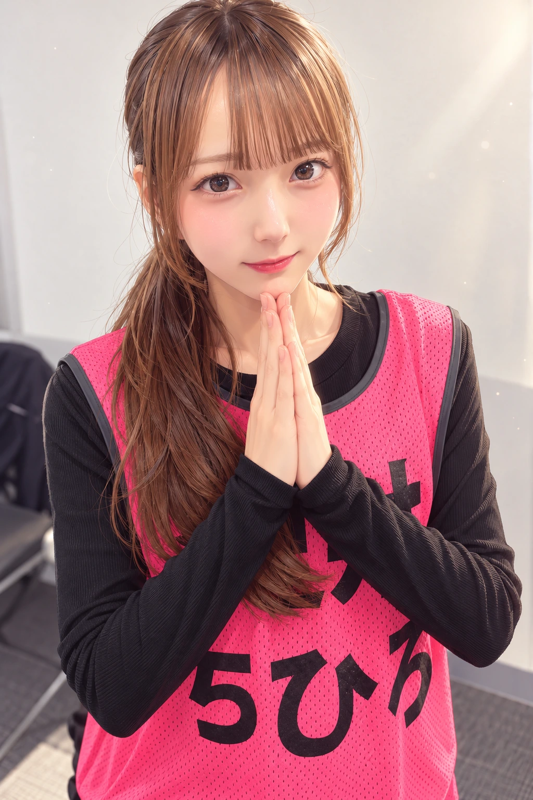
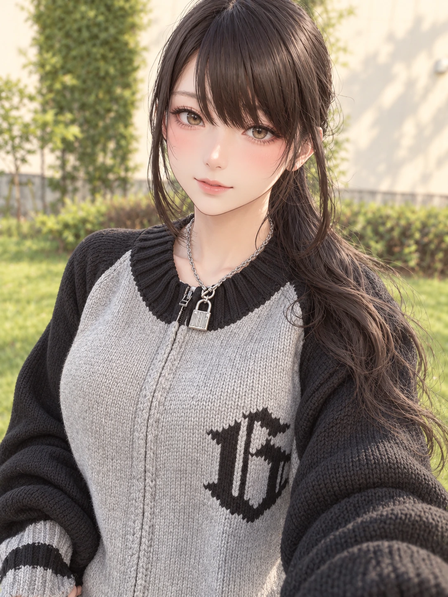

# 新キャラ8人の案(2026-11-05)

画像8枚から作った新キャラ案。**採用は未決定**。全員20歳以上。
既存キャラ(Ver.0.27.0.0時点の名前一覧)と名字・名前・キャラID・職業が被らないように作成。

| 画像 | 名前(ID・年齢) | 職業・設定 | 既存キャラとのつながり |
|---|---|---|---|
|  | 柊 すず(suzu・24) | 駅前シネコンのスタッフ。映画オタクで、話し方はちょっと皮肉っぽい | 駅前組(結衣・莉子)の顔なじみ |
|  | 椎名 あやね(ayane・22) | 港の商業施設の雑貨店員。手作りスマホケースの作家でもある | 同じ施設のちよと仲良し |
|  | 早乙女 みゆ(miyu・21) | 学園ドラマのロケで宵星市に来た若手女優。制服は役の衣装 | ロケ地の案内役がしずく |
|  | 一ノ瀬 アリサ(arisa・26) | 港のショーレストランのパフォーマー。ポリス衣装はショーの定番演目 | 玲子のクラブ「ドック」の常連出演者 |
|  | 桂木 ことは(kotoha・28) | ドレスのアトリエのデザイナー。落ち着いた大人枠 | セナの仕事仲間 |
|  | 北条 ゆきの(yukino・25) | 鉄道好きの旅行ライター。「消えた灯」の噂を取材しに来た外の人 | 記者の響子と情報を取り合う |
|  | 小鳥遊 ねね(nene・22) | イベント会社の新人スタッフ。試験点灯や点灯式の設営担当 | 観光課長の百合子の下で動く |
|  | 九条 ゆかり(yukari・24) | シルバーアクセ工房の職人。無口だが手先は確か。南京錠を旧灯台の鍵の小道具に | 冴子の宝石店に作品を卸す |

## 物語に絡めやすい子
- 北条ゆきの:外から来た取材者として謎に近づける
- 小鳥遊ねね:点灯式の準備側にいるので第5章・第9章の舞台に自然に立てる
- 九条ゆかり:南京錠を「旧灯台の鍵」の小道具に使える

## 絵の注意
- 01・06・07は実写寄り、05は水彩寄り。カード絵にするときは同じキャラの中で立ち絵と同じ顔にそろえる
- 07のビブスの文字が崩れているので、作り直すときは「文字なし」か正しい文字を指定
- 04は露出が多めなので、基本の立ち絵は別衣装にして、この絵はUR(特別衣装)枠に回す案

## ほかの候補案との被り(採用時に要調整)
- 椎名あやね(ayane)：7人案の赤坂うらら(urara)と名前・IDが同じだったため、椎名うららから改名済み
- 九条ゆかり ⇔ 7人案の九条すみれ:名字が同じ
- 柊すず(suzu) ⇔ 4人案の鳳すずね(suzune):名前・IDが近い
